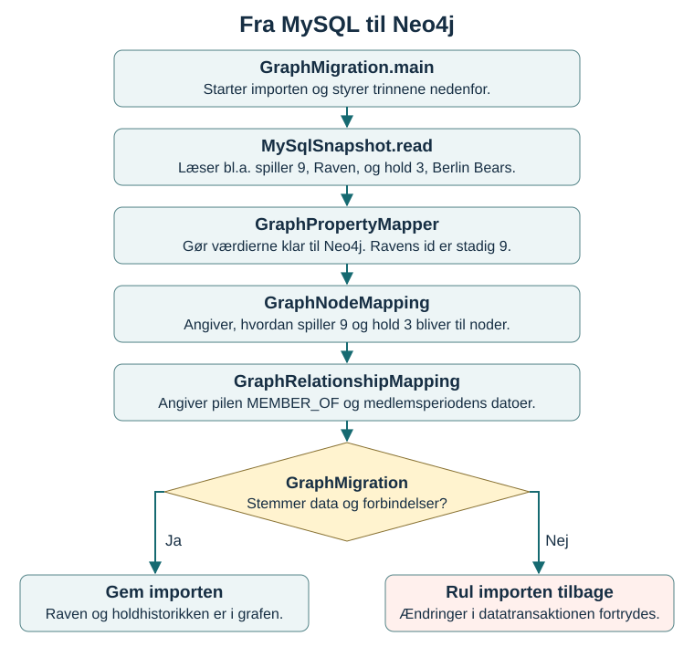
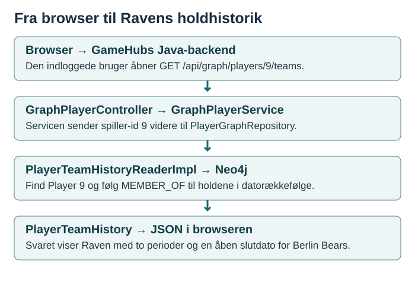

# Neo4j i GameHub

Vi bruger Neo4j til at undersøge forbindelser mellem spillere, hold og kampe. MySQL indeholder allerede de data, vi skal bruge. En Java-kommando læser dem én gang og bygger grafen. Efter importen kan GameHub fx svare på “Hvilke hold har Raven spillet på, og hvornår?” ved at følge spillerens medlemskaber.

[Se grafmodellen](graph-design.md) · [Kør migreringen lokalt](local-setup.md) · [Hent figurer til rapporten](figurer/)

## Kommandoer til migrering og rydning

Kør fra GameHub-projektets rod.

| Hvad vil du gøre? | Terminalkommando |
|---|---|
| Start MySQL og Neo4j | `docker compose up -d gamehub_db neo4j` |
| Tjek at databaserne kører | `docker compose ps` |
| Importér fra MySQL til Neo4j, også efter en rydning | `./mvnw spring-boot:run -Dspring-boot.run.main-class=com.gamehub.migration.GraphMigration` |
| Vis hvad der kan ryddes i Neo4j | `./scripts/clear-neo4j.sh` |
| Stop Neo4j efter testen | `docker compose stop neo4j` |

**Rydning er valgfri.** Scriptet viser destination og antal. Tryk Enter for at annullere, eller skriv `CLEAR` og tryk Enter for at slette GameHub-noderne og deres mappede relationer. MySQL-data og Neo4js unikhedsregler bevares. Vil du teste fra en tom graf, så vent på at rydningen afsluttes, og kør derefter importkommandoen igen.

## Sådan foregår migreringen

*Figur 3. Følg Raven fra en række i spillertabellen til en spiller med to holdperioder i grafen.*

### 1. Læs spiller, hold og medlemskaber

Når vi starter [GraphMigration](../../src/main/java/com/gamehub/migration/GraphMigration.java), kalder den [MySqlSnapshot.read](../../src/main/java/com/gamehub/migration/MySqlSnapshot.java). Den læser alle 14 tabeller, som de så ud på samme tidspunkt, og holder rækkerne i hukommelsen under importen. Det er dét, vi kalder et *øjebliksbillede*.

I Ravens eksempel står der, at spiller 9 hedder Raven, at hold 3 hedder Berlin Bears, og at spiller 9 kom på hold 3 den 1. januar 2025.

Hvis en tabel er tom, er der nul rækker at flytte. Hvis tabellen mangler, stopper importen.

### 2. Gør værdierne klar til grafen

En *egenskab* er en enkelt oplysning om noget, fx spillerens navn eller nummer. [GraphPropertyMapper](../../src/main/java/com/gamehub/mapper/graph/GraphPropertyMapper.java) kopierer de fleste oplysninger direkte. Navnet `Raven` bliver stadig til `Raven`. En sejrsprocent gemmes derimod som et heltal med to underforståede decimaler.

### 3. Opret spilleren og forbind ham med holdet

[GraphNodeMapping](../../src/main/java/com/gamehub/mapper/graph/GraphNodeMapping.java) fortæller, at rækken fra `players` bliver en `Player`-node, som vi kan finde på id 9.

[GraphRelationshipMapping](../../src/main/java/com/gamehub/mapper/graph/GraphRelationshipMapping.java) fortæller, at rækken fra `team_players` bliver en pil fra spiller 9 til hold 3. På pilen står `MEMBER_OF` og startdatoen. Ravens tidligere periode hos Copenhagen Wolves får sin egen pil med både start- og slutdato.

### 4. Tjek resultatet og gem

I vores test læste migratoren 12 medlemsperioder fra MySQL. Den tjekkede både antallet i grafen og hver enkelt forbindelse. Ravens periode fra januar 2025 skal pege på *Berlin Bears*. Selv hvis der er 12 pile i alt, ville et forkert hold give en fejl.

Ved succes gemmes importen samlet. Ved fejl fortrydes denne kørsels dataændringer. Reglerne om unikke id’er oprettes før importen og kan derfor blive stående.

### Eksempler på værdier før og efter importen

| Eksempel | Fra MySQL til Neo4j | Hvorfor? |
|---|---|---|
| Spillerens nummer | `players.id = 9` → `Player.id = 9` | *Kilde-id* betyder bare nummeret fra MySQL. Hvis Java læser det som typen `BigInteger`, laver `GraphPropertyMapper` det om til en heltalstype, Neo4j kan gemme. Tallet er stadig 9, så medlemskabet kan finde Raven. |
| Starten på en holdperiode | `2025-01-01 00:00:00` → `2025-01-01T00:00:00` i Neo4j Browser | Begge betyder midnat den 1. januar. Det er `MySqlSnapshot`, der læser datoen og klokkeslættet. `T` er blot den måde, browseren adskiller de to på. |
| En periode uden slutdato | `left_at = NULL` → ingen `left_at` på pilen | MySQL har ingen slutdato for Ravens periode hos Berlin Bears. Derfor står der heller ingen slutdato på forbindelsen. I API-svaret ser vi `leftAt: null`. |
| En sejrsprocent (regneeksempel) | `win_rate = 12.34` → `win_rate_hundredths = 1234` | `GraphPropertyMapper` ganger med 100, så begge decimaler kan gemmes præcist som et heltal. Det svarer til at gemme 12,34 kr. som 1234 øre. Procenten er stadig 12,34 %. Tabellen var tom i vores første test. |

### Hvis importen køres igen

Ved en ny kørsel læses MySQL igen. Hvis data er de samme, finder migratoren Raven på id 9 og genbruger hans medlemsperioder. Hvis en eksisterende værdi i grafen er i konflikt med det nye øjebliksbillede, afbrydes importen. [Se de tre mapperklasser](../../src/main/java/com/gamehub/mapper/graph/).

## Sådan bruger Java grafen

*Figur 4. Efter login læser GameHub holdhistorikken direkte fra Neo4j.*

Når en indlogget bruger åbner `GET /api/graph/players/9/teams`, går kaldet gennem disse trin.

| Trin | Klasse | Opgave |
|---|---|---|
| Modtag | [GraphPlayerController](../../src/main/java/com/gamehub/controller/GraphPlayerController.java) | Modtager spiller-id 9 fra browseren. |
| Slå op | [GraphPlayerService](../../src/main/java/com/gamehub/service/GraphPlayerService.java) | Beder spillerens repository om holdhistorikken. |
| Læs grafen | [PlayerTeamHistoryReaderImpl](../../src/main/java/com/gamehub/graphrepository/PlayerTeamHistoryReaderImpl.java) | Følger medlemskaberne til holdene og sorterer efter startdato. |
| Svar | [PlayerTeamHistory](../../src/main/java/com/gamehub/dto/PlayerTeamHistory.java) | Beskriver JSON-svaret med navn og medlemsperioder. |

Grafopslaget er en del af [PlayerGraphRepository](../../src/main/java/com/gamehub/graphrepository/PlayerGraphRepository.java). En spiller uden medlemskaber får en tom liste. Et ukendt id giver HTTP 404.

### Hvor bruges graf-entiteterne?

[PlayerNode](../../src/main/java/com/gamehub/entity/graph/PlayerNode.java) og [TeamNode](../../src/main/java/com/gamehub/entity/graph/TeamNode.java) er Java-typerne til de to repositories’ almindelige id-opslag. Migratoren bruger Neo4j-driveren direkte. Holdhistorikken læser også felterne direkte fra grafen ind i DTO’en. Derfor behøver disse to funktioner ikke en Java-entitet for hver nodetype.

## Hvad viste vores test?

| Kontrol | Observeret resultat |
|---|---|
| Første gennemførte import | Migratoren godkendte alle 14 tabeller. Tre var tomme: `app_users`, `match_status_history` og `player_statistics`. |
| MySQL sammenlignet med Neo4j Browser | Alle 12 medlemsperioder matchede på spiller, hold og datoer. Alle 6 kampe matchede på id, deltagere, status og vinder. |
| Statistik for enkelte games | Alle 24 rækker matchede på game, spiller, hold, champion, kills, deaths og assists. |
| Java-API | Spiller 9, Raven, havde Copenhagen Wolves i 2024 og Berlin Bears fra 1. januar 2025 med åben slutdato. |
| Rydning og genimport | Efter rydning viste Neo4j Browser ingen noder. Efter genimport blev grafen synlig igen. |

For Neo4j-delen demonstrerer testen både grafalternativet og engangsmigreringen med gruppens dummydata. Den første kørsel dokumenterer nul rækker for de tre tomme tabeller. Den giver ingen eksempler på feltværdier fra de tabeller. MongoDB er gruppens separate del af afleveringen.
