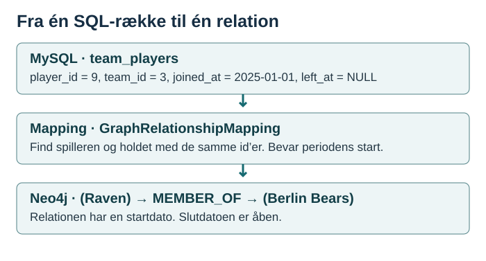
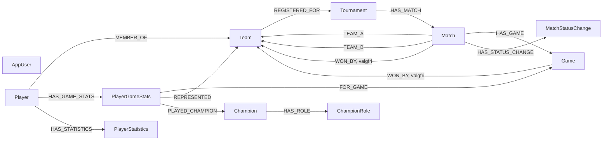

# GameHubs grafmodel

MySQL er kilden til GameHubs data. I Neo4j kan man følge forbindelser direkte, fx fra en spiller gennem et medlemskab til et hold. En **node** er en ting, fx holdet Berlin Bears. En **relation** forbinder to noder. Både noder og relationer kan have **egenskaber**, fx holdets navn eller datoen, hvor en spiller kom på holdet.

## Fra SQL til graf

*Figur 1. I testdataene kom Raven på Berlin Bears den 1. januar 2025. Datoen hører til forbindelsen mellem spilleren og holdet. Hvis Raven vender tilbage senere, får den nye periode sin egen relation.*

## Hele modellen

*Figur 2. Kasserne viser nodetyper, og pilene viser relationernes retning. En kamp og et game får hver en vinderrelation, når MySQL indeholder et vinder-id. En login-konto står alene, fordi SQL-modellen ikke forbinder konti med spillere.*

En statistiklinje for et game får sin egen node, `PlayerGameStats`. Den samler fire referencer: spiller, game, hold og champion. På den måde kan man stadig se, hvem spilleren repræsenterede i netop dette game, efter et senere holdskifte.

## Opslag for alle 14 tabeller

Hver række i en kildetabel bliver til én af de viste noder eller relationer. Fremmednøgler gemmes også som egenskaber, så en række kan spores tilbage til MySQL.

| MySQL-tabel | Graf og identitet | Kildefelter |
|---|---|---|
| `app_users` | `AppUser`, nøgle `id` | `id`, `email`, `role`, `is_enabled`, `created_at` |
| `players` | `Player`, nøgle `id` | `id`, `nickname`, `created_at`. |
| `teams` | `Team`, nøgle `id` | `id`, `name`, `short_name`, `created_at`. |
| `team_players` | `Player` → `MEMBER_OF` → `Team`, nøgle `(team_id, player_id, joined_at)` | `team_id`, `player_id`, `joined_at`, `left_at` |
| `champions` | `Champion`, nøgle `id` | `id`, `name`, `released_at`. |
| `champion_roles` | `ChampionRole`, nøgle `id` | `id`, `name` |
| `champions_has_champion_roles` | `Champion` → `HAS_ROLE` → `ChampionRole`, nøgle `(champions_id, champion_roles_id)` | `champions_id`, `champion_roles_id` |
| `tournaments` | `Tournament`, nøgle `id` | `id`, `name`, `start_date`, `end_date`, `created_at`. |
| `tournament_teams` | `Team` → `REGISTERED_FOR` → `Tournament`, nøgle `(tournament_id, team_id)` | `tournament_id`, `team_id`, `registered_at` |
| `matches` | `Match`, nøgle `id` | `id`, `tournament_id`, `team_a_id`, `team_b_id`, `format`, `status`, `winner_team_id`, `scheduled_at`, `created_at` |
| `games` | `Game`, nøgle `id` | `id`, `match_id`, `game_number`, `winner_team_id`, `started_at`, `ended_at`, `created_at` |
| `player_game_stats` | `PlayerGameStats`, nøgle `(game_id, player_id)` | `game_id`, `player_id`, `team_id`, `champion_id`, `kills`, `deaths`, `assists` |
| `match_status_history` | `MatchStatusChange`, nøgle `id` | `id`, `match_id`, `old_status`, `new_status`, `changed_at` |
| `player_statistics` | `PlayerStatistics`, nøgle `player_id` | `player_id`, `games_played`, `wins`, `losses`, `win_rate`, `updated_at` |

`app_users.password_hash` er gruppens aftalte undtagelse fra kopieringen. Rapporten bør nævne den, fordi opgaven siger “all the data”. GameHub bruger fortsat MySQL til login.

## Hvilke værdier bevarer vi?

- SQL-id’et identificerer noden i grafen. Unikhedsregler beskytter også sammensatte nøgler som `(game_id, player_id)`.
- SQL `NULL` bliver en fraværende egenskab. I API-svaret vises en åben slutdato som `leftAt: null`.
- En `DATE` bevarer sin dato. `DATETIME` bevarer lokal dato og klokkeslæt, mens `TIMESTAMP` læses i UTC.
- `win_rate` lagres som heltallet `win_rate_hundredths`. Eksempelvis bliver 12,34 % til 1234, så begge decimaler bevares. Et heltal uden for Neo4js interval giver en fejl.
- Historik og gemte spillerstatistikker kopieres med deres oprindelige værdier og tidspunkter. MySQL står fortsat for procedurer, triggers og planlagte opdateringer.

Se [migreringen og testresultaterne](README.md) eller [kør den lokalt](local-setup.md).
