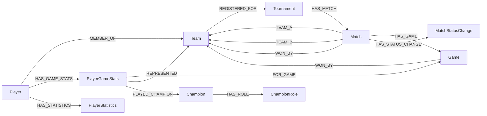

# GameHub: Neo4j graph design

Status: proposed design, based on the MySQL initialization scripts in `data/database/init`. The migration and queries have not yet been implemented or verified. MySQL is the source of truth; this design describes a one-time snapshot, not ongoing synchronization.

## Current local database

A read-only inspection on 2026-11-17 found 11 base tables in the running local `gameHub` database. `match_status_history` and `player_statistics` and the two views were absent, although their creation scripts exist. The design covers all 13 tables in the scripts; the migration must inspect and report the actual source schema rather than assume these additional tables exist. Do not re-run initialization scripts against existing data without first checking their effects.

## Graph

Relationships are directed as shown. `WON_BY` is absent when the SQL winner is NULL. Multiple membership relationships between the same player and team are allowed, distinguished by `joined_at`.

## Mapping every table

Property names below use the SQL column names to simplify tracing. SQL primary keys and foreign-key references are retained as properties as well as represented by relationships. This provides an audit trail and permits row-by-row verification. Null SQL values correspond to absent properties. Preserve date/time precision and the distinction between MySQL DATETIME and TIMESTAMP; agree on a timezone for TIMESTAMP conversion before implementation. Neo4j integers are signed 64-bit, whereas MySQL BIGINT UNSIGNED can exceed that range; migration must detect unsupported values rather than silently truncate them. Preserve DECIMAL win rates exactly, for example as integer hundredths of a percentage point, with a documented conversion.

| MySQL table | Graph representation | Properties and identity |
|---|---|---|
| players | Player | `id`, `nickname`, `created_at`; key `id` |
| teams | Team | `id`, `name`, `short_name`, `created_at`; key `id` |
| team_players | Player -[:MEMBER_OF]-> Team | `team_id`, `player_id`, `joined_at`, `left_at`; key `(team_id, player_id, joined_at)` |
| champions | Champion | `id`, `name`, `released_at`; key `id` |
| champion_roles | ChampionRole | `id`, `name`; key `id` |
| champions_has_champion_roles | Champion -[:HAS_ROLE]-> ChampionRole | `champions_id`, `champion_roles_id`; composite key |
| tournaments | Tournament | `id`, `name`, `start_date`, `end_date`, `created_at`; key `id` |
| tournament_teams | Team -[:REGISTERED_FOR]-> Tournament | `tournament_id`, `team_id`, `registered_at`; composite key |
| matches | Match, linked from Tournament and to Team nodes | `id`, `tournament_id`, `team_a_id`, `team_b_id`, `format`, `status`, `winner_team_id`, `scheduled_at`, `created_at`; key `id` |
| games | Game, linked from Match and to winning Team | `id`, `match_id`, `game_number`, `winner_team_id`, `started_at`, `ended_at`, `created_at`; key `id` |
| player_game_stats | PlayerGameStats, linked to Player, Game, Team and Champion | `game_id`, `player_id`, `team_id`, `champion_id`, `kills`, `deaths`, `assists`; key `(game_id, player_id)` |
| match_status_history | MatchStatusChange linked from Match | `id`, `match_id`, `old_status`, `new_status`, `changed_at`; key `id` |
| player_statistics | PlayerStatistics linked from Player | `player_id`, `games_played`, `wins`, `losses`, exact `win_rate`, `updated_at`; key `player_id` |

`PlayerStatistics` is the stored snapshot from MySQL, including its timestamp; it may differ from a freshly calculated value. Existing status history rows must be copied as-is, not regenerated.

## Existing MySQL functionality

The migration copies data, not SQL routines or their enforcement. The following list records the intended behavior to reproduce if required. See `01_gamehub_v7.sql` for the authoritative details.

| Routine or feature | Existing behavior | Proposed graph equivalent |
|---|---|---|
| `fn_team_match_win_rate` | Completed matches only; returns NULL for no results and errors for unknown team | Read query; preserve rounding and edge cases |
| `fn_team_game_win_rate` | Completed games in in-progress or completed matches; excludes cancelled matches; NULL for no results | Read query with equivalent filters |
| `sp_get_tournament_standings` | All registered teams, including those without results; completed matches only; results overview rather than points/tie-break rules | Read query with equivalent ordering and NULL handling |
| `sp_save_team_membership` | Saves a period; same player/team periods cannot overlap; end is exclusive; different teams may overlap | Future write service with validation and concurrency control |
| `sp_record_game_result` | Validates participants, dates and consecutive games; calculates match status and winner atomically | Future transactional write service with equivalent validation and concurrency control |
| `sp_save_player_game_stats` | Validates participating team and non-negative stats; does not require membership record | Future transactional write service with equivalent validation |
| `trg_matches_status_history` | Records match status changes | Existing rows migrate; future write behavior requires a separate implementation |
| `ev_refresh_player_statistics` | Periodically updates stored aggregate statistics | Existing rows migrate; future refresh requires a separate implementation |
| `vw_player_leaderboard`, `vw_match_overview` | Readable views over existing data | Cypher read queries |
| Constraints and indexes | Enforce and optimize parts of the relational model | Define suitable Neo4j constraints/indexes; document rules that remain in application code |

## Questions for read queries

1. Which teams has a player belonged to, and during which periods?
2. Which players, teams and champions participated in a particular game, and what were their kills, deaths and assists?
3. What are each team's completed match results in a tournament, including teams without completed matches?
4. What are a team's match and game win rates under the same conditions as the SQL functions?
5. How has a match's status changed over time?

## Migration and verification plan

1. Read all 13 tables from one consistent MySQL snapshot. Coordinate the exact schema version with the group.
2. Create entity nodes, then relationship rows and dependent nodes. Preserve keys, values and nullable fields; do not generate history or recalculate aggregates.
3. Use stable source identities to prevent accidental duplication on retry. Decide how to handle an existing target and failures before implementation.
4. Compare source row counts to corresponding node/relationship counts, and compare keys, values, nulls and endpoints. Test repeated membership periods, missing winners, no-result teams, history and statistics.
5. Compare read-query results with MySQL, including rounding, zero-result and nonexistent-ID cases.

A one-time migration does not make Neo4j a live replica. Supporting independent graph writes, synchronization, or the original rules for all database clients is a separate group decision.
